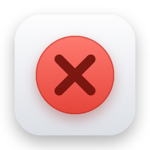
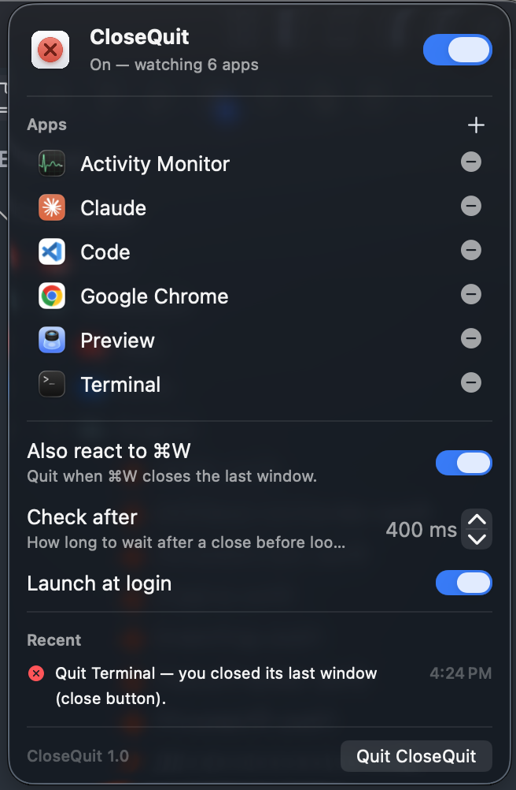

<p align="center">
  
</p>

<h1 align="center">CloseQuit: Quit Mac Apps When You Close the Last Window</h1>

<p align="center">
  <strong>Close an app's last window with the red close button or ⌘W, and the app quits, the way it works on Windows.</strong><br>
  A free, open-source menu bar app for macOS. It only touches the apps you choose, and it's built to never quit an app you didn't close yourself.
</p>

<p align="center">
  <a href="https://github.com/MehbubRashid/CloseQuit/releases/latest"></a>
  
  
  
  <a href="LICENSE"></a>
</p>

---

On a Mac, closing an app's last window usually doesn't quit the app. It keeps running in the Dock, using memory and battery, until you remember to press ⌘Q. **CloseQuit** fixes that: add the apps you want, and closing their last window quits them.

**[⬇ Download CloseQuit for macOS](https://github.com/MehbubRashid/CloseQuit/releases/latest)**. Requires macOS 14 Sonoma or later on an Apple Silicon Mac (M1 or later).

<p align="center">
  
</p>

## Features

- **Red close button and ⌘W.** Close the last window the way you always do, and the app quits.
- **Only the apps you choose.** Add apps with **+** in the menu bar. CloseQuit never touches any other app.
- **Never quits an app you didn't close.** It reacts only to your own clicks and keystrokes, checks twice before quitting, and does nothing when it isn't sure.
- **Unsaved work stays safe.** Apps quit normally, so they still ask to save changes. If a "Save changes?" dialog appears, CloseQuit waits for your answer.
- **Aware of Spaces and full screen.** An app that still has a window on another desktop or in full screen stays open.
- **Lightweight and private.** A native Swift menu bar app with no Dock icon. It's event-driven (no polling), has no network access and collects no data.
- **Launch at login**, a pause switch, and a **Recent** list that shows every decision and why.

## Why doesn't a Mac app quit when I close its window?

On macOS, an app and its windows are separate things. The red close button and ⌘W close a *window*; the app keeps running, which is why its Dock icon still has a dot under it. A few apps, such as System Settings, quit with their last window, but most don't, and macOS has no setting to change that. You normally quit with ⌘Q or **Quit** from the Dock. CloseQuit gives you that Windows-style "close the last window to quit" behavior, for exactly the apps you pick.

## Download and install

1. Download **CloseQuit-x.y.z.zip** from the [latest release](https://github.com/MehbubRashid/CloseQuit/releases/latest) and unzip it.
2. Drag **CloseQuit.app** into your **Applications** folder and open it.
3. macOS will say Apple could not verify CloseQuit, because it isn't notarized. Open **System Settings ▸ Privacy & Security**, scroll down and click **Open Anyway**. If you prefer Terminal:
   ```sh
   xattr -dr com.apple.quarantine /Applications/CloseQuit.app
   ```
4. Click the CloseQuit icon in the menu bar, choose **Open Accessibility Settings…**, and switch CloseQuit on.
5. Click **+** and add the apps that should quit when you close their last window.

> **Can't see the menu bar icon?** On a MacBook with a notch it can be hidden behind the notch when the menu bar is full. Look in the menu bar of an external display, ⌘-drag other icons out of the way, or use a menu bar manager such as Thaw or Bartender.

## How to use CloseQuit

| In the menu | What it does |
|---|---|
| **On/off switch** | Pauses CloseQuit completely |
| **Apps** and **+** | The only apps CloseQuit will ever quit. Add an open app, or choose any app from Applications |
| **Also react to ⌘W** | Quit when ⌘W closes the last window (on by default) |
| **Check after** | How long to wait after a close before looking at the app's windows (200–2000 ms, default 400 ms) |
| **Launch at login** | Start CloseQuit when you log in |
| **Recent** | Each decision and the reason, for example "Kept Safari open: 2 windows are still open" |

## How CloseQuit decides (and why it's safe)

CloseQuit never scans for "apps without windows". Every decision starts with something you did:

- **Red close button:** your click must press *and release* on the close button of a real window in an app on your list. Dragging off the button before releasing cancels it, just as it cancels the close.
- **⌘W:** a plain ⌘W (no other modifiers) must reach the frontmost app, that app must be on your list, and it must have had a window open when you pressed ⌘.

Then:

1. Wait 400 ms and look at the app's windows. Only real windows count, including minimized and full-screen ones; floating palettes and popovers don't.
2. If none are left, look again 300 ms later. Some apps, such as Chrome while you drag tabs, briefly close and reopen windows.
3. If there are still none, ask the app to quit normally. CloseQuit never force-quits.
4. If a sheet or dialog is open ("Save changes?"), keep watching for up to 30 seconds. Quit only if the last window then closes; if you press Cancel, CloseQuit stops watching.

CloseQuit **leaves the app running** whenever anything is unclear:
- the app still has a window on another Space or in full screen;
- a window is on screen that macOS doesn't report;
- the app is hidden, or the Mac goes to sleep or locks;
- the app takes longer than half a second to answer;
- you switch Spaces in the middle of a check.

## FAQ

### How do I make a Mac app quit when I close the last window?
Install CloseQuit, allow it in **Accessibility** settings, and add the app with **+**. From then on, closing that app's last window with the red close button or ⌘W quits it.

### Will CloseQuit quit apps I didn't close?
No. That's its first rule. It only acts on apps you added, only right after you close a window yourself, and it checks twice before quitting. If anything is uncertain, it does nothing. The **Recent** list shows every decision and why.

### Will I lose unsaved changes?
No. CloseQuit asks apps to quit the normal way, the same as ⌘Q, so an app with unsaved work still asks you to save. It never force-quits.

### Does it work with Chrome, Safari, VS Code, Slack and other apps?
It works with apps that use standard macOS windows, which is most of them. In tabbed apps like Chrome and Safari, ⌘W closes a tab, so the app quits when the last tab of its last window closes. If an app doesn't quit, the **Recent** list says why.

### Does CloseQuit work with ⌘W?
Yes. ⌘W is on by default, and you can turn it off in the menu. It's detected on QWERTY keyboard layouts; on layouts such as AZERTY, use the red close button.

### Why does CloseQuit need Accessibility access?
To see which window you closed and whether an app has windows left. macOS only allows that for apps you approve in **Privacy & Security ▸ Accessibility**. CloseQuit doesn't read window contents. Its keyboard listener reacts only to ⌘W and records nothing you type. It makes no network connections.

### Why does macOS say Apple could not verify CloseQuit?
CloseQuit isn't notarized by Apple, so macOS asks you to confirm the first launch. Use **Open Anyway** in **Privacy & Security** (see [Download and install](#download-and-install)), or build it yourself from source.

### Which Macs and macOS versions are supported?
Apple Silicon Macs (M1 or later) running macOS 14 Sonoma, macOS 15 Sequoia or macOS 26 Tahoe and later.

### Is CloseQuit an alternative to Swift Quit or RedQuits?
Yes. Like them, it quits apps when their last window closes. CloseQuit is stricter: it works only on the apps you add, only after a close you made yourself, and it leaves an app running whenever it isn't sure.

### Is CloseQuit free?
Yes. It's free and open source under the MIT license.

## Build from source

You need Xcode and [XcodeGen](https://github.com/yonaskolb/XcodeGen) (`brew install xcodegen`).

```sh
git clone https://github.com/MehbubRashid/CloseQuit.git
cd CloseQuit
echo 'DEVELOPMENT_TEAM = AB12CD34EF' > Config/Local.xcconfig   # your Apple Team ID
make install
```

Your Team ID is shown in Xcode ▸ Settings ▸ Accounts; a free Personal Team works. CloseQuit is signed with your Apple Development certificate rather than ad hoc, so macOS keeps its Accessibility permission when you rebuild.

| Command | What it does |
|---|---|
| `make` | Generate the Xcode project and build Release into `./build` |
| `make install` | Build, copy to `/Applications` and launch |
| `make release` | Build and zip the app for a GitHub release |
| `make test` | Run the unit tests for the decision rules |
| `make open` | Open the generated project in Xcode |

```
project.yml              XcodeGen spec (app and unit tests)
Config/Signing.xcconfig  signing template; your Team ID goes in Config/Local.xcconfig
CloseQuit/App            app entry point, settings and app list
CloseQuit/UI             the menu bar window (SwiftUI)
CloseQuit/Engine         event tap, Accessibility, window server, decision pipeline
CloseQuit/Core           pure decision rules (unit-tested)
CloseQuitTests           tests for the rules
```

## Troubleshooting

- **See every decision live:**
  ```sh
  log stream --info --predicate 'subsystem == "com.closequit.CloseQuit"'
  ```
- **Accessibility looks on but nothing happens** (for example after moving to a build signed by someone else): run `tccutil reset Accessibility com.closequit.CloseQuit`, reopen CloseQuit, and allow it again.
- **An app doesn't quit:** the **Recent** list explains why. Common reasons are a window on another Space, or an app that draws its own close button; ⌘W still works for those.

## Contributing

Bug reports and pull requests are welcome. If CloseQuit ever quits an app you didn't close, please [open an issue](https://github.com/MehbubRashid/CloseQuit/issues) with the steps and the `log stream` output above.

## License

[MIT](LICENSE) © 2026 MehbubRashid
